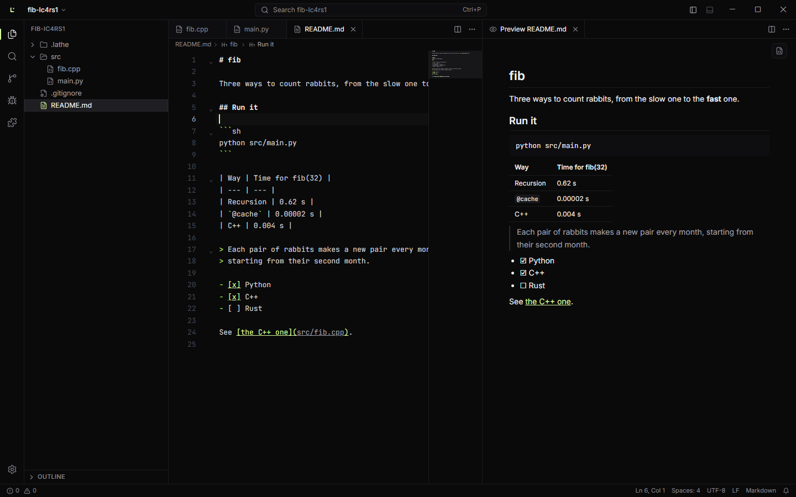

# Lathe

A fast, minimal code editor for Windows 11. Edit, run, debug, search and commit in a quiet
"Mono" look: near-black, hairline dividers and one lime accent, with a light twin.

Lathe is built with Tauri 2 (Rust) and React, and its editor is CodeMirror 6. It is not a
VS Code reskin and contains no VS Code code, but it works the way VS Code users expect: the
same keys, `settings.json` and `keybindings.json` in VS Code's format, and a one-click import of
your VS Code settings, keybindings and snippets.



## What it does

- **Editing:** multi-cursor, find and replace, folding, minimap, sticky scroll, Emmet, snippets,
  Vim mode, split editors, preview and pinned tabs, unsaved work kept across restarts.
- **Run** any file with ▶ (Ctrl+F5): Python, JavaScript, TypeScript, C and C++ (MSVC, clang or
  g++), Java, Rust, Go, C#, Ruby, PHP, Lua, PowerShell and Bash, in a terminal that takes input.
  Lathe finds your toolchains and offers to install missing ones with winget, asking first.
- **Terminal:** PowerShell, cmd, Git Bash and WSL, with tabs, splits and clickable `file:line`.
- **Search** across files with regex, globs and replace, respecting `.gitignore`.
- **Language smarts** from language servers: completions, errors, go to definition, references,
  rename, code actions, formatting and inlay hints. Lathe downloads the servers it needs (after
  asking), pinned and checked.
- **Debugger:** breakpoints (conditional, hit count, logpoints), stepping, variables, watches
  and a debug console, for Python, JavaScript/TypeScript and C/C++/Rust.
- **Git:** stage hunks from the gutter, commit, branches, push and pull, diffs side by side or
  inline, blame, file history and local history.
- **Notebooks:** `.ipynb` files with a real Jupyter kernel (plots, rich output, interrupt and
  restart), and `# %%` cells in Python files.
- **Plugins:** commands, colour themes (VS Code themes work), snippets, language servers and
  status bar items, each running in its own sandbox. See [docs/plugins.md](docs/plugins.md).
- **Settings and keys:** a searchable Settings editor (Ctrl+,), a Keyboard shortcuts editor that
  records keys and shows clashes (Ctrl+K Ctrl+S), and a Markdown preview that scrolls with its
  file (Ctrl+K V).

## Install

Run `Lathe_<version>_x64-setup.exe`. It installs for you alone (no administrator rights) and
adds:

- **Open with Lathe** to the menus of files, folders and folder backgrounds (under "Show more
  options" on Windows 11);
- Lathe to "Open with" and to Settings › Apps › Default apps for code files, without changing
  what any file type opens with;
- `lathe` to your PATH (open a new terminal after installing).

Uninstalling takes all of it out again.

## From a terminal

```powershell
lathe .                 # this folder
lathe src\main.py:12    # a file, at line 12
lathe --wait notes.md   # returns when you close the file
```

To make Lathe Git's editor (commit messages, interactive rebases):

```powershell
git config --global core.editor "lathe --wait"
```

## Coming from VS Code

The first time Lathe starts next to a VS Code installation, it offers to bring your settings,
keybindings and user snippets across (also in the palette: **Preferences: Import from VS
Code**). Settings Lathe has are translated; keybindings to commands Lathe has are kept, with
your `-command` removals.

Your own files live in `%LOCALAPPDATA%\app.lathe`: `settings.json`, `keybindings.json` and
`snippets\` (VS Code's format, `<language>.json` or `*.code-snippets`). A folder's own settings
go in `.lathe/settings.json`; Lathe also reads the common fields of `.vscode/tasks.json` and
`.vscode/launch.json`.

## Develop

You need Windows 11, Node 24+, pnpm 11, Rust 1.99+ (MSVC) and Visual Studio Build Tools with
the C++ workload.

```powershell
pnpm install
pnpm dev              # the app, with the UI reloading as you edit
pnpm verify           # every check: format, lint, types, unit and end-to-end tests
pnpm verify --quick   # the same without the debug build and end-to-end tests
pnpm build            # the installer, in target\release\bundle\nsis
pnpm licenses:report  # docs/licenses.md
```

## Layout

```
apps/lathe/            React UI (src/) and the Tauri shell (src-tauri/)
crates/lathe-core/     the engine: files, text, processes, terminals, search, Git, LSP, DAP, kernels
crates/lathe-testkit/  fakes for tests: language server, debug adapter, kernel
packages/plugin-api/   the plugin API (TypeScript)
plugins/               sample plugins
e2e/                   end-to-end tests that drive the real app
docs/                  architecture, decisions (adr/), Windows build notes, status, licenses
```

Read [docs/architecture.md](docs/architecture.md) for how the pieces fit,
[docs/adr/](docs/adr/README.md) for why they are the way they are, and
[docs/STATUS.md](docs/STATUS.md) for what's done.
